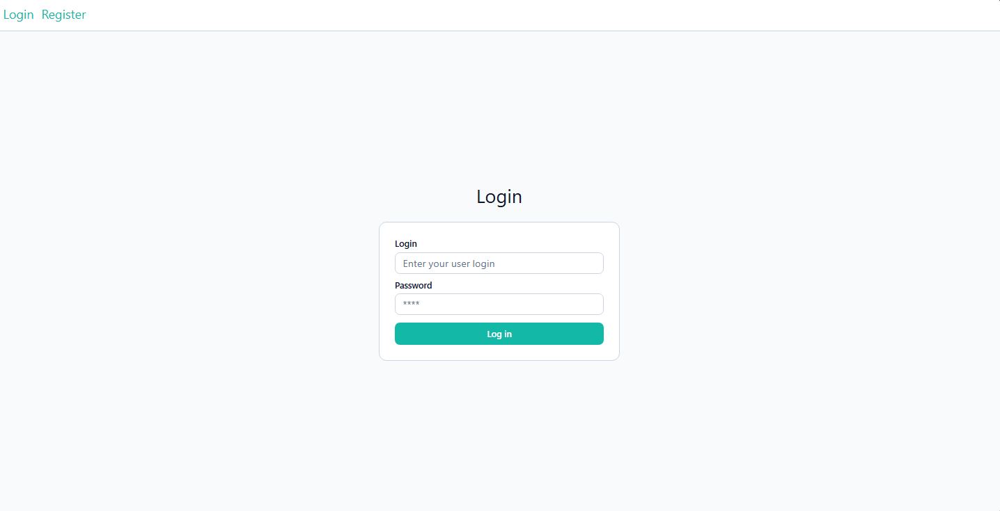
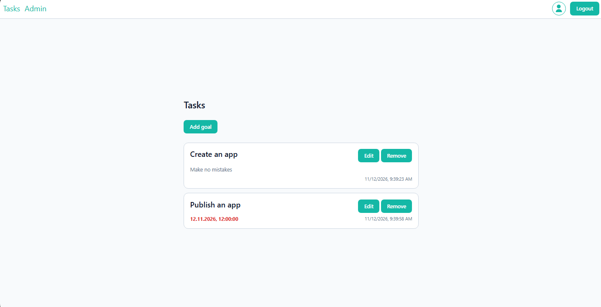
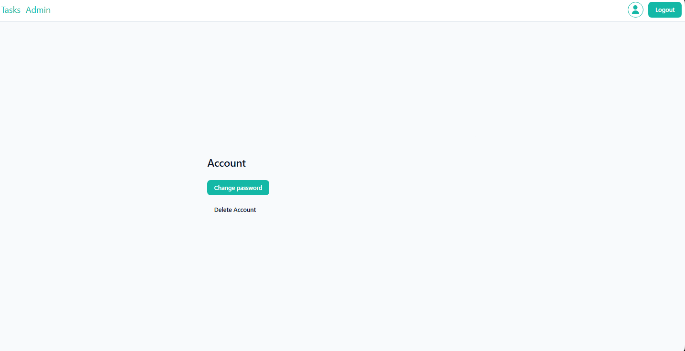
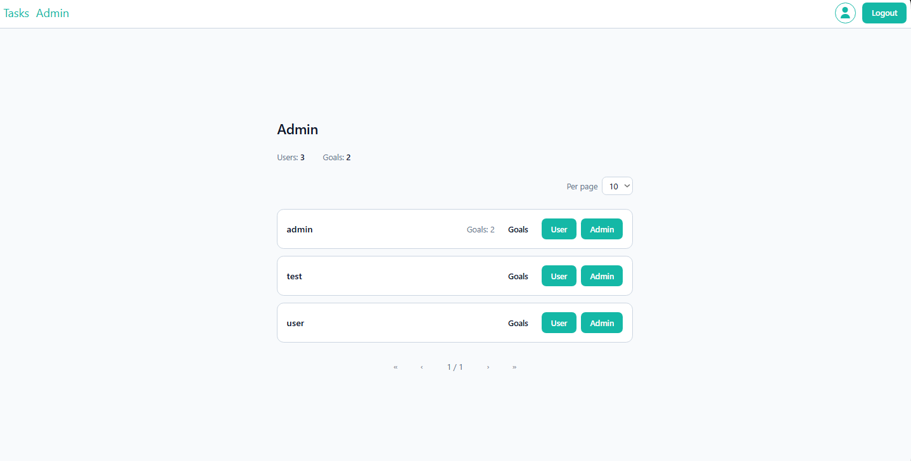

# Task list

[](https://github.com/Ka666aH/TaskList/actions/workflows/ci.yml)   

## Пет-проект для отработки реализаций технологий на практике.

### Функционал

#### Роли:

1. Клиент

- Регистрация, вход, выход.
- Управление задачами (CRUD).
- Управление аккаунтом (смена пароля, удаление).

2. Администратор

- Клиентские функции.
- Смена роли пользователя.
- Просмотр показателей (количество пользователей, получение пользователей по страницам, количество задач, количество задач у пользователя).

### Скриншоты

| Вход                    | Задачи                    | Аккаунт                      | Админ                           |
| ----------------------- | ------------------------- | ---------------------------- | ------------------------------- |
|  |  |  |  |

### Реализованные технологии и практики

#### Бэкенд

- Луковая архитектура
- PostgreSQL 18
- Entity Framework Core 10
- BCrypt 4 (хэширование паролей)
- IMemoryCache (кэширование)
- JWT (аутентификация/авторизация)
- DotNetEnv (локальное получение секретов)
- xUnit и FluentAssertions (интеграционные тесты)
- Coverlet и ReportGenerator (формирование отчётов о покрытии кода)

#### Фронтенд

- Vue 3 + TypeScript
- Vue Router
- TanStack Query (кэширование серверных данных)
- vee-validate + zod (формы и валидация)
- Tailwind CSS 4
- Vite + pnpm
- ESLint + oxlint + Prettier

### Тестирование и покрытие кода

#### Бэкенд

Проект покрыт интеграционными тестами с использованием xUnit и FluentAssertions. Покрытие кода превышает 90%. Отчёты о покрытии генерируются с помощью Coverlet и ReportGenerator.

Запуск тестов:

```
cd .\TaskList.Tests\
dotnet test
```

Формирование отчёта:

```
cd .\TaskList.Tests\
coverlet "bin\debug\net10.0\tasklist.tests.dll" --target "dotnet" --targetargs "test --no-build" --format "opencover" --output "coverage.opencover.xml" --exclude-by-file "**/migrations/*" --exclude-by-file "**/*designer.cs" --exclude-by-file "**/obj/**" --exclude "[infrastructure]infrastructure.migrations.*" --exclude "[presentation]microsoft.aspnetcore.openapi.generated.*" --exclude "[domain]domain.exceptions.*exception"
reportgenerator -reports:coverage.opencover.xml -targetdir:coveragereport -reporttypes:Html
```

Отчёт доступен по пути: `.\TaskList.Tests\coveragereport\index.html`

#### Фронтенд

Юнит-тесты — Vitest + Vue Test Utils.

E2E — Playwright: сценарий «регистрация → CRUD задач → смена пароля → удаление аккаунта». Тест удаляет свои данные из БД (самоочистка после прогона, включая хвосты упавших запусков).

```
cd .\frontend\
pnpm test:unit   # юнит-тесты
pnpm test:e2e    # e2e, нужен запущенный бэкенд
```

CI (GitHub Actions): lint → type-check → юнит-тесты → сборка. Статус — бейдж в шапке README.

## Инструкция

Точка входа — фронтенд: `http://localhost:8080` (порт задаётся переменной FRONTEND_PORT, см. «Переменные окружения»).

Бэкенд наружу не публикуется: внутри сети Compose nginx проксирует запросы `/api` на task-list. Swagger UI (http://localhost:5000/swagger/index.html) доступен, только если раскомментировать публикацию портов бэкенда в docker-compose.yml.

### Docker Compose

Для запуска с помощью Docker Compose необходим исходный код приложения, так как используется многоступенчатая сборка.

Перед запуском необходимо указать переменные окружения в .env файле (необходимый файл находится в корне приложения).

В корне приложения, где хранится docker-compose.yml, выполнить команду (в зависимости от версии):

```
docker-compose up
```

или

```
docker compose up
```

### Переменные окружения

- FRONTEND_PORT – порт, на котором наружу публикуется фронтенд (по умолчанию 8080).
- POSTGRESQL_USER – пользователь СУБД (по умолчанию dev_user). Необходимо указать существующего в СУБД пользователя, например postgres (пользователь PostgreSQL по умолчанию).
- POSTGRESQL_PASSWORD – пароль пользователя СУБД (по умолчанию dev_password).
- JWT_KEY – секретный ключ JWT, используемый для шифрования подписи токена. Минимальная длина ключа 32 символа (по умолчанию testkeytestkeytestkeytestkeytestkey).
- DEFAULT_ADMIN_PASSWORD – пароль администратора по умолчанию (по умолчанию admin).

### Особенности

При первом запуске приложения будет создан администратор по умолчанию с логином admin.

Все регистрирующиеся пользователи являются клиентами.

Стандартный WeatherForecast оставлен как контроллер, не требующий аутентификации.
